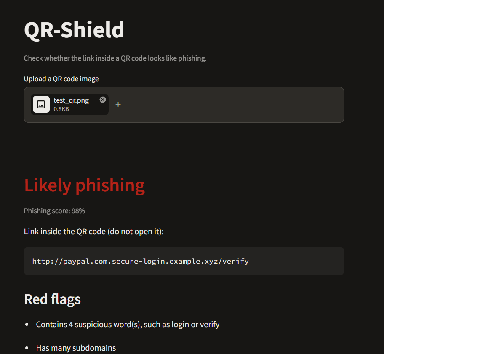

# QR-Shield

A Python tool that decodes a QR code, extracts the link inside, and estimates whether it looks like phishing. It also lists the red flags it found.

## Why this project

QR code phishing ("quishing") is growing because people cannot read a URL hidden inside a QR code. QR-Shield shows the link before anyone opens it and scores how suspicious it looks.

## How it works

1. OpenCV decodes the QR code image and extracts the URL.
2. 12 features are calculated from the URL text (length, dots, hyphens, digits, subdomains, suspicious words, IP address use, @ symbol, link shorteners, slashes, special characters, hostname length).
3. A Random Forest model gives a phishing probability.
4. A Streamlit page shows the verdict, the link, and the red flags.

The tool never opens or visits the link. It only reads the URL as text.

## Results

Trained on 100,000 URLs sampled from the Kaggle "Phishing Site URLs" dataset, after removing duplicates. 80/20 train/test split.

| Version | Phishing precision | Phishing recall | Phishing F1 |
|---|---|---|---|
| 9 features | 0.79 | 0.55 | 0.65 |
| 12 features | 0.72 | 0.80 | 0.76 |

Overall accuracy on the test set: 89%.

Adding three features (hostname length, slashes, special characters) raised phishing F1 from 0.65 to 0.76. Accuracy alone would be misleading, because about 78% of the URLs are legitimate.

## Run it

1. Create a virtual environment and install: pandas, scikit-learn, matplotlib, opencv-python-headless, qrcode, streamlit
2. Download the dataset and run `python build_dataset.py`, then `python train_model.py`
3. Run `streamlit run app.py`

## Limitations

- The model only looks at the text of the URL. It does not check domain age, page content, or reputation lists.
- It misses about 20% of phishing URLs and wrongly flags some legitimate ones.
- The dataset is older than current attacks, so new tricks may not be caught.
- Some features, like the shortener list, are very rare in the data, so they barely affect the model.
- The score is an estimate, not a guarantee.

## Notes

Built as a one-week learning project. I used an AI assistant for guidance and debugging, and I wrote and tested the feature extraction and evaluation steps myself.
